<picture>
  <source media="(prefers-reduced-motion: reduce)" srcset="assets/technical-practice-cloud-alternative.svg#static">
  
</picture>

<strong>Explore the complete technical skill set</strong>

| Area | Tools and approaches |
| :--- | :--- |
| **AI & retrieval** | LangGraph · Hierarchical RAG, vector search, reranking · Test-driven feedback loops |
| **Backend & architecture** | Python, PHP · FastAPI, Django, Laravel · REST APIs, domain-driven design |
| **Data & integration** | PostgreSQL, MariaDB, Elasticsearch · Redis, RabbitMQ, Celery · Keycloak, OAuth2/OIDC |
| **Infrastructure & delivery** | Docker, Linux, Nginx · GitLab CI, Argo CD, Ansible · AWS, Kubernetes |
| **Quality & observability** | PHPUnit, Vitest, Playwright · Static analysis · OpenTelemetry, Prometheus, Grafana |

# Architecture with production in mind.

### 15+ YoE in software design, delivery and operations.

Building core backends, integrations, and infrastructure for **public- and private-sector leaders**. Spanning B2B/B2C platforms, payment systems, public services, and modern AI-assisted delivery.

I have worked as a developer, team lead and solutions architect. Bridging the gap between: **designing how systems work and owning how they run.**

  <a href="https://www.linkedin.com/in/stemizer"><strong>Experience on LinkedIn</strong></a> &nbsp; / &nbsp;
  <a href="mailto:info@stemizer.net"><strong>Get in touch</strong></a> &nbsp; / &nbsp;
  <a href="https://medium.com/@stemizer">Writing</a>

---

## Experience that informs the architecture

<table>
<tr>
<td width="50%" valign="top">
<h3>Business systems &amp; integrations</h3>

Unified payment integrations into a dedicated domain, eliminating redundant B2B workflows. Extended CRM services with messaging integrations and introduced OAuth2/OIDC single sign-on.

<strong>Payments · Identity · CRM/ERP integration</strong>

</td>
<td width="50%" valign="top">
<h3>Public services &amp; reliability</h3>

Operated resilient citizen-service platforms integrated with multi-channel communication tools. Tuned database and cache configuration to improve availability; delivered on-premises services for exam-result publication.

<strong>API operations · Queues · Databases · On-premises</strong>

</td>
</tr>
<tr>
<td valign="top">
<h3>From data to working products</h3>

Built an electronic auction platform, e-commerce business-intelligence integrations and ETL pipelines. Earlier work includes official document management and home-healthcare service applications.

<strong>B2B / B2C · ETL · Web services · Product delivery</strong>

</td>
<td valign="top">
<h3>Architecture &amp; delivery ownership</h3>

Led engineering teams, defined system blueprints, and mitigated technical risks. Built staging environments and CI/CD workflows, bringing automated quality checks into day-to-day delivery.

<strong>System design · Team leadership · CI/CD · Operations</strong>

</td>
</tr>
</table>

## Open source, with a purpose

### [Nesti](https://github.com/samettemizer/nesti) — autonomous developer
**AI-assisted development, with test gates before human review.**

Flagship project: a Python/LangGraph pipeline turning GitLab issues into verified merge requests for Laravel & Vue. It brings planning, code generation, retrieval and execution into a development loop.

> **The core boundary is verification;** automated test suites running inside ephemeral Docker sandboxes. Failed checks feed a bounded retry loop; passing changes become a merge request for human review, not an automatic production deployment.

Hierarchical retrieval, vector search and reranking are part of my current engineering focus: supplying useful context to agents while keeping their output accountable to executable checks.

[Explore Nesti's architecture and source →](https://github.com/samettemizer/nesti)

Nesti's python graph implementation and accompanying tests were selected by [XERJ](https://xerj.org/) team for inclusion in its public Corpus Hub as a worked reference for coding agents.

<table>
<tr>
<td width="50%" valign="top">
<h3><a href="https://github.com/samettemizer/skillpluck">skillpluck</a></h3>

<strong>Focused reuse for agent tooling.</strong> Install selected skills from Git repositories with their resolved static local references and licences. Rewrites references without executing source scripts.

PYTHON · CLI · DEVELOPER TOOL
</td>
<td width="50%" valign="top">
<h3><a href="https://github.com/samettemizer/django-domain-repositories">django-domain-repositories</a></h3>

<strong>Less manual wiring in domain-driven Django.</strong> Discover repository implementations and bind them to contracts using a consistent naming convention.

PYTHON · DJANGO · DOMAIN-DRIVEN DESIGN
</td>
</tr>
<tr>
<td valign="top">
<h3><a href="https://tinyfinder.stemizer.net" target="_blank">TinyFinder</a></h3>

<strong>File management where content is edited.</strong> A compact upload and search tool for rich-text editors, with a FastAPI-backed version and separate Vue and Filament integrations.

<a href="https://github.com/samettemizer/tinyfinder">FastAPI</a> · <a href="https://github.com/samettemizer/vue_tinyfinder">Vue</a> · <a href="https://github.com/samettemizer/filament_tinyfinder">Filament</a>

</td>
<td valign="top">
<h3><a href="https://github.com/samettemizer/fuat">Fuat</a></h3>

<strong>Apartment / Residential Complex Management.</strong> FuatAmca provides a REST API for apartment building managers.

.NET 9 · EF COE · POSTGRESQL
</td>
</tr>
</table>

**Package registries:** [Packagist.org](https://packagist.org/packages/stemizer/) &nbsp; / &nbsp; [PyPI.org](https://pypi.org/user/stemizer/) &nbsp; / &nbsp; [All repositories](https://github.com/samettemizer?tab=repositories)

---

### Let's discuss the system you need to build — or make dependable.

Based in **Istanbul & Ankara, Türkiye**. Open to engineering roles and open-source collaboration involving backend systems, architecture, infrastructure and AI orchestration.

**[info@stemizer.net](mailto:info@stemizer.net)** &nbsp; · &nbsp; [LinkedIn](https://www.linkedin.com/in/stemizer) &nbsp; · &nbsp; [GitHub](https://github.com/samettemizer) &nbsp; · &nbsp; [Medium](https://medium.com/@stemizer)
